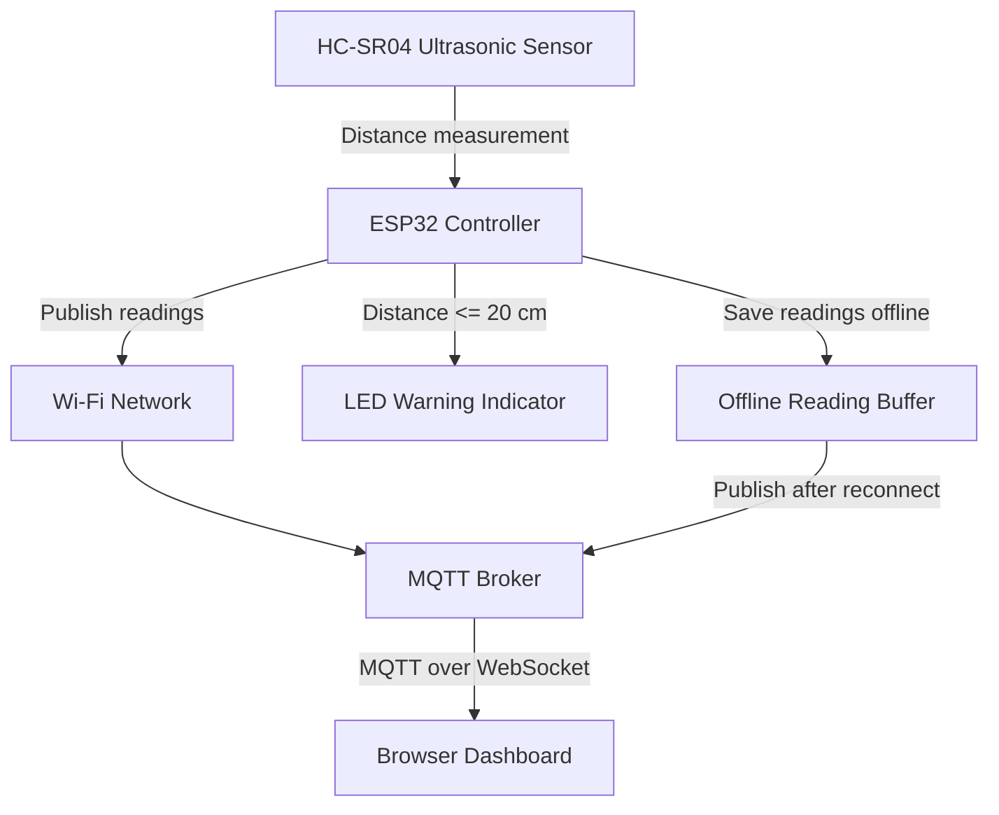

# System Architecture Diagram

## Smart Distance Monitoring IoT System

## Data Flow

1. The HC-SR04 sensor measures the distance to an object.
2. The ESP32 reads the sensor data.
3. The LED turns on when the measured distance is 20 cm or less.
4. The ESP32 publishes valid readings to the MQTT broker over Wi-Fi.
5. The browser dashboard subscribes to the MQTT topic and displays new readings.
6. When MQTT is unavailable, readings are stored temporarily in the ESP32 RAM buffer.
7. When the connection returns, buffered readings are published.

## Reliability Notes

- Wi-Fi and MQTT reconnection attempts are included.
- Up to 20 readings are stored in RAM.
- The oldest reading is removed if the buffer becomes full.
- Buffered readings are lost when the device restarts.
- The public MQTT broker is for demonstration only.
